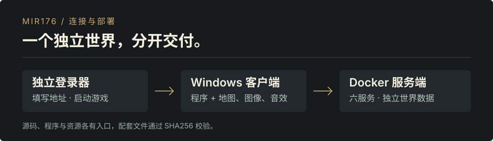

# github.com/suneveryday/Mir176

**面向 Windows PC 的《热血传奇》1.76 还原工程：Docker 服务端与独立登录器。**

[下载服务端与登录器](https://github.com/suneveryday/Mir176/releases) · [取得 PC 客户端](https://github.com/suneveryday/Mir176Client) · [Docker 部署](deployment/README.md) · [参与维护](CONTRIBUTING.md)

<picture>
  <source media="(max-width: 600px)" srcset="assets/readme/system-mobile.svg">
  
</picture>

项目以 2003 年中国大陆《热血传奇》1.76“重装上阵”的游戏体验为目标。服务端、客户端和资源分别交付，登录器允许使用者填写服务器地址。当前提供还原预览版，部分参数为工程采用值，完整运行组合仍待验证。


## 选择需要的内容

| 内容 | 源码 / 说明 | 下载位置 |
| --- | --- | --- |
| Docker 服务端 | [server/](server/README.md) | 本仓库 Release：`Server-Docker` |
| Windows 独立登录器 | [launcher/](launcher/README.md) | 本仓库 Release：`Launcher` |
| Windows 游戏客户端 | [Mir176Client](https://github.com/suneveryday/Mir176Client) | 客户端仓库 Release：`Client-Program` |
| 地图、图像与音效 | [资源说明](resources/README.md) | 客户端仓库 Release：`Resources` / `Server-Maps` |

本仓库的 `client/` 和 `resources/` 仅提供介绍与项目链接。客户端源码、资源清单和素材包由 Mir176Client 维护。

## 启动一个服务端

1. 从本仓库 Release 下载并解压 `Server-Docker` 包。
2. 从 [Mir176Client Release](https://github.com/suneveryday/Mir176Client/releases) 下载约 7.2 MB 的 `Server-Maps` 包，放在 `deploy.sh` 同级目录，无需解压。
3. 准备 Python 3.9+、Docker Engine 与 Compose v2，在服务端包目录运行：

```sh
sh deploy.sh
```

按提示填写玩家可达的地址和端口。入口会核对文件与地图散列、导入地图并准备 Docker 部署。首次安装需要独立空数据库；已有配置时会停止，升级与备份方法见 [部署说明](deployment/README.md)。

## 连接游戏

从客户端仓库下载 `Client-Program` 和 `Resources`，解压到同一个新目录。运行 `Check-Client.cmd`，检查通过后打开 `Mir176Launcher.exe`，填写服务器地址与登录端口。账号和密码在游戏窗口内输入。

## 从源码构建

服务端使用 .NET 8；登录器使用 Windows 的 .NET Framework C# 编译器。

```sh
bash tools/build-server.sh
python3 tools/check-contract.py
python3 tools/check-privacy.py
```

Windows 登录器：

```powershell
launcher/build-on-windows.ps1 -OutputDirectory .build/launcher
tests/launcher/run-windows.ps1 -OutputDirectory .build/launcher-tests
```

当前配套为服务端 **0.1.4**、客户端 **0.1.5**、登录器 **0.1.6**。精确文件、资源集合与散列以 [distribution.json](distribution.json) 为准；构建、完整性校验和实机验收分别处理。

## 文档与许可

[安装与配套](docs/DISTRIBUTION.md) · [兼容性](docs/COMPATIBILITY.md) · [代码规范](docs/CODING_STANDARDS.md) · [第三方声明](THIRD_PARTY.md)

服务端源码许可见 [server/LICENSE](server/LICENSE)，第三方组件保留各自许可与署名。客户端及游戏素材的使用和再分发权需分别确认；本项目不代表官方授权，也不对素材授予新许可。
